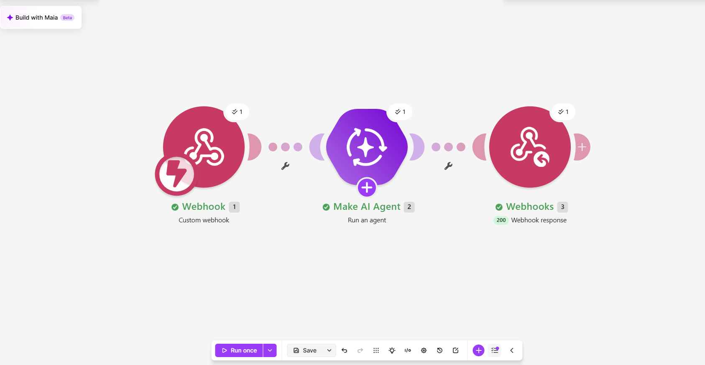
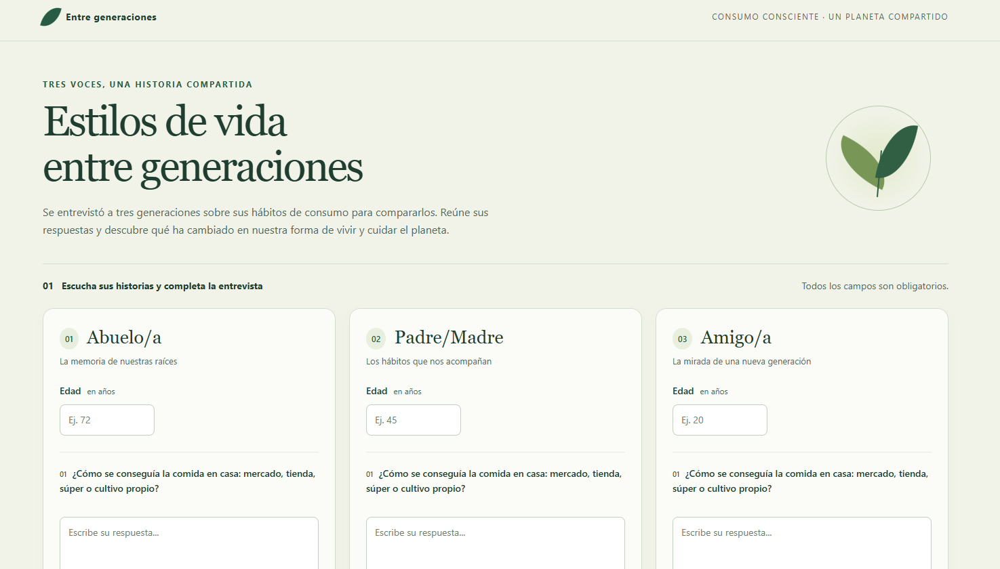

# Nombre del proyecto
Estilos de vida entre generaciones

## Descripción
Se entrevistó a tres generaciones —abuelo/a, padre/madre y amigo/a— sobre sus hábitos de consumo para compararlos y reflexionar sobre su relación con el ambiente.

La página web permite registrar la edad y las respuestas de cada persona a ocho preguntas sobre comida, ropa, aparatos electrónicos, transporte, basura, desechables, agua y lo necesario para vivir bien. Las respuestas se envían a un escenario de Make mediante un webhook; un agente de inteligencia artificial las compara y devuelve un análisis en texto.

## Objetivos de aprendizaje
- Comparar los hábitos de consumo de tres generaciones.
- Reflexionar sobre el consumo responsable y el cuidado del ambiente.
- Crear una página responsive con HTML, CSS y JavaScript, sin librerías externas.
- Integrar un formulario web con un webhook y un agente de inteligencia artificial en Make.
- Validar los datos y mostrar el análisis recibido de forma clara.

## Material utilizado
- Computadora o celular con navegador y conexión a internet.
- Entrevistas a tres personas de distintas generaciones.
- HTML, CSS y JavaScript.
- Make: webhook, agente de inteligencia artificial y respuesta del webhook.
- GitHub para almacenar los archivos del proyecto.

## Diagrama del flujo
El formulario envía las respuestas al webhook de Make. El agente procesa las tres entrevistas y el módulo de respuesta devuelve el análisis a la página.

Formulario web → Webhook → Make AI Agent → Respuesta del webhook → Análisis en la página.

## Código
- [Página web: index.html](index.html)
- [Blueprint del escenario de Make](c%C3%B3digo/estilos%20de%20vida.blueprint.json)

Para utilizar el proyecto:
1. Abre `index.html` en un navegador.
2. Completa las edades y las ocho respuestas de cada persona.
3. Presiona **Comparar respuestas**.
4. Espera a que aparezca el análisis debajo del botón.

El escenario de Make debe estar activo y conectado al webhook configurado en `WEBHOOK_URL`. El formulario envía los campos `abuelo`, `padre` y `amigo` mediante POST como formulario, y muestra la respuesta como texto plano.

Para reutilizar el escenario, importa el blueprint en Make, configura sus conexiones y sustituye `WEBHOOK_URL` por la dirección de tu propio webhook.

## Video del funcionamiento
[Ver VideoPrueba.mp4](video/VideoPrueba.mp4)

El video de prueba no contiene audio.

## Evidencias del proyecto
Página de captura de las entrevistas:

Integración del formulario con Make:

## Conclusiones
El proyecto integra un formulario web y un escenario de Make para facilitar la comparación de hábitos de consumo entre generaciones. Las entrevistas permiten reflexionar sobre prácticas que pueden contribuir al cuidado del ambiente.

Las conclusiones sobre qué hábitos son más sustentables deben basarse en las respuestas recopiladas. El análisis del agente sirve como apoyo para esa reflexión y debe revisarse a partir de lo expresado por las personas entrevistadas.

## Resultados
La página presenta la comparación recibida de Make como texto plano, conservando los saltos de línea. El escenario está diseñado para organizar la respuesta en comparación por tema, análisis y conclusiones.

- [Captura de la página](imagenes/pagina-web.png)
- [Captura del escenario de Make](imagenes/escenario-make.png)
- [Video de prueba](video/VideoPrueba.mp4)

La carpeta [resultados](resultados/) está disponible para agregar el reporte o las evidencias del análisis de las entrevistas; actualmente no contiene un reporte.
